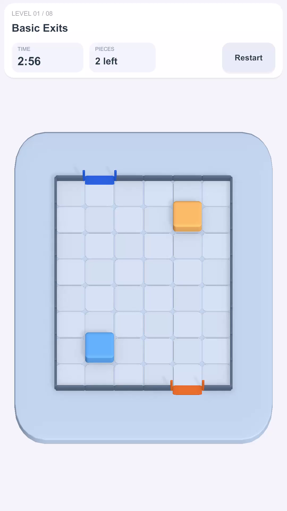
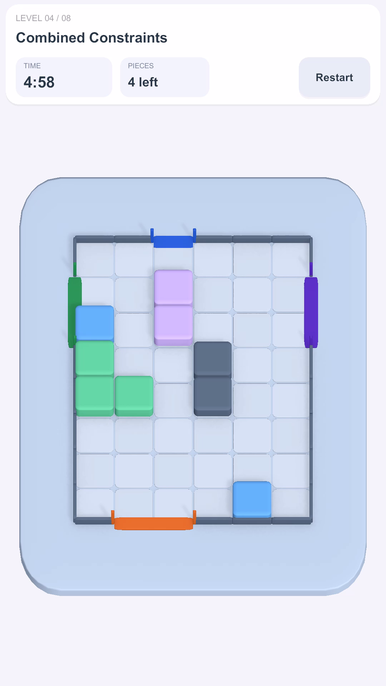
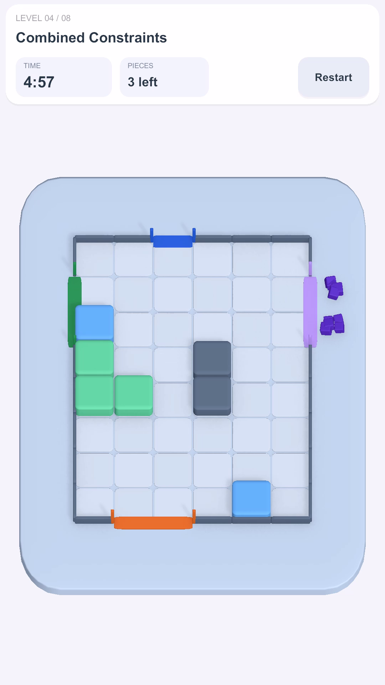
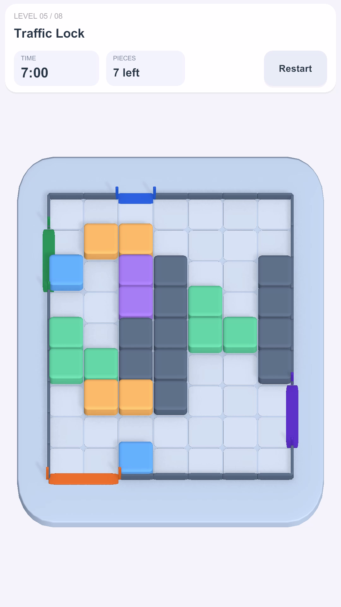
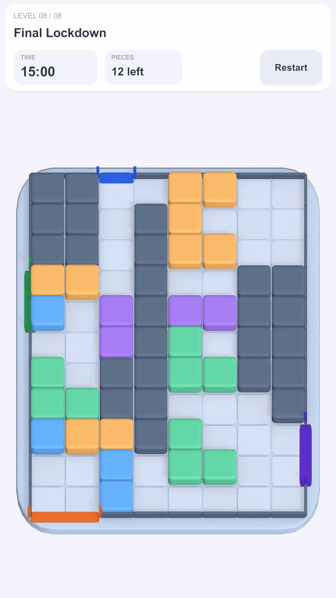
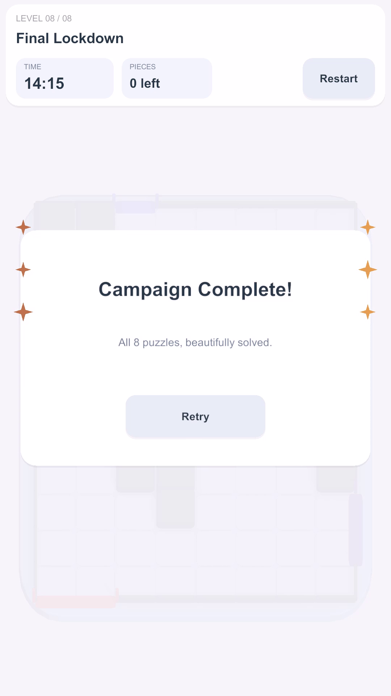

# ColorSlide3D

A portrait 3D sliding-block puzzle built with Unity 6 and C#. Route colored pieces through matching gates and clear the board before time runs out.

The engineering focus is deterministic puzzle rules, reusable level presentation, automated tests, and responsive visual and audio feedback.

## Gameplay video

**ColorSlide3D — Full Gameplay Showcase**

The approved continuous recording covers all eight levels and the Campaign Complete screen: **2:29.6**, **1080×1920** portrait, **60 FPS** nominal, with in-game audio.

**Video link pending:** the MP4 is ready for manual upload as a GitHub Release asset. It is kept outside the source repository. See the [media report and upload instructions](docs/M5-C-Portfolio-Media.md#manual-github-release-upload).

## Screenshots

Six genuine frames from the approved recording. Select an image to view its original **1080×1920** PNG.

<table>
  <tr>
    <td align="center"> <strong>Basic gameplay</strong> Level 1 — Basic Exits</td>
    <td align="center"> <strong>Block interaction</strong> Level 4 — Combined Constraints</td>
  </tr>
  <tr>
    <td align="center"> <strong>Soft Cube Burst</strong> Cosmetic exit feedback</td>
    <td align="center"> <strong>Traffic Lock</strong> Level 5 — 7×9 board</td>
  </tr>
  <tr>
    <td align="center"> <strong>Final Lockdown</strong> Level 8 — 8×11 board</td>
    <td align="center"> <strong>Campaign Complete</strong> Final result and celebration</td>
  </tr>
</table>

[Source timestamps and integrity checks](docs/M5-C-Portfolio-Media.md#screenshot-provenance)

## Gameplay

- Drag squares, rectangles and L-shaped pieces using mouse or primary touch.
- Navigate obstacles and occupied cells; exits must match the piece's color and width.
- Clear every piece to win. Restart/Retry restores the current puzzle; Next advances after a win.
- Progress through eight authored levels. Progress is held in memory for the current Play session.

| Level | Board | Puzzle focus |
| --- | --- | --- |
| 1 — Basic Exits | 6×8 | Learn dragging and color-matched exits |
| 2 — Make Space | 6×8 | Move one piece to open another's route |
| 3 — Irregular Footprints | 6×8 | Route L-shaped pieces around obstacles |
| 4 — Combined Constraints | 6×8 | Coordinate several shapes and shared routes |
| 5 — Traffic Lock | 7×9 | Resolve congestion and transfer-lane dependencies |
| 6 — Grand Escape | 8×10 | Plan movement across separated board regions |
| 7 — Chain Reaction | 8×11 | Build a sequence of dependent rearrangements |
| 8 — Final Lockdown | 8×11 | Manage the campaign's most crowded challenge |

## Implementation highlights

- **Puzzle model:** `GridBoard` validates exact footprints, cardinal movement, swept paths and legal exits. `PuzzleSession` owns time, results and restart snapshots. Raycasts select pieces; physics does not decide moves.
- **Campaign presentation:** `CampaignSession` handles progression; `LevelPresentation` builds and retires owned scene objects. ScriptableObject levels 1–4 and source-authored levels 5–8 share one validation/presentation pipeline.
- **Input and HUD:** Input System pointer actions, persistent imported UI action references, UGUI controls, safe-area layout and protection against dragging through UI.
- **Adaptive camera:** orthographic fitting targets ~90% tray width within board, gate, HUD and safe-area constraints, without scaling the logical grid.
- **Authoring validation:** bounded Editor search and stored solution witnesses exercise production rules. Master-level witnesses are valid solutions, not claimed shortest solutions.

Rounded geometry, contact shadows and selection feedback give the board a toy-plastic appearance. **Soft Cube Burst is cosmetic animation, not Rigidbody destruction.** Gate pulses, blocked-contact feedback, timer urgency and win celebration accompany six synthesized cues: Select, Blocked, Exit, UiClick, Win and Fail.

## Technology

| Area | Stack |
| --- | --- |
| Engine / language | Unity **6000.3.8f1 LTS**, C# |
| Rendering | Universal Render Pipeline **17.3.0** |
| Input / interface | Input System **1.18.0**, UGUI **2.0.0** |
| Tests | Unity Test Framework **1.6.0**, NUnit EditMode tests |
| Target presentation | Android portrait; 1080×1920 reference layout |

## Open and play

1. Clone/download the repository and add its root folder to Unity Hub.
2. Open with **Unity 6000.3.8f1**; let packages import and compilation finish.
3. Open `Assets/_ColorSlide/Scenes/FeedbackCampaign.unity`.
4. Choose **1080×1920 fixed resolution** in Game View and press **Play**. No setup/Apply commands are needed.

Editor QA: focus Game View and press **5–8** for advanced levels. **Equals/Plus** and **Minus** (also numpad; Shift+Equals supported) adjust the temporary **1.00–1.25** camera control in 0.01 steps. Default: **1.25**. QA controls are excluded from player builds and save no progression/overrides.

## Testing and validation

Latest author-confirmed Unity EditMode result: **243/243 passed**. Static audit: Runtime, Android-defined Runtime, Editor and Tests compiled; **179 managed cases passed**, zero failures. The audit did not rerun the 64 cases requiring native Unity services.

Coverage spans movement/occupancy, exits, timers, restart/progression, solution witnesses, cleanup, UI references, keyboard shortcuts, camera bounds and pointer projection.

Run `ColorSlide.Tests.EditMode` in **Window > General > Test Runner > EditMode** after saving scene edits. `Tools/Verify-M46.ps1` optionally compiles and runs managed checks using locally imported Unity dependencies, without launching Unity.

See the [final project audit](docs/M5-Project-Audit.md) for evidence, configuration limits and outstanding checks.

## Project status and source map

The eight-level Editor prototype and gameplay recording are accepted; six portfolio screenshots are ready and the external video link awaits manual Release publication. Physical Android testing, APK release and Google Play publication are unverified. Build Settings still points to template `SampleScene`. Render-settings reference debt and release-configuration gaps are recorded in the audit.

| Location | Responsibility |
| --- | --- |
| `Assets/_ColorSlide/Runtime/Board`, `Gameplay` | Grid rules, level data, sessions, campaign and presentation |
| `Assets/_ColorSlide/Runtime/Input`, `Interaction`, `Polish` | Pointer handling, views, camera, feedback and audio playback |
| `Assets/_ColorSlide/Editor` | Authoring/validation tools, solver witnesses and Play Mode QA controls |
| `Assets/_ColorSlide/Tests/EditMode` | Automated regression suite |
| `Assets/_ColorSlide/Scenes/FeedbackCampaign.unity` | Current playable entry scene |
| `docs`, `Tools` | Technical reports, portfolio preparation and managed validation |

[Camera framing details](docs/M4.6-Unified-Camera-Framing.md) · [Master-level design and witnesses](docs/M4.6-Phase-B-Master-Levels.md) · [CV and portfolio descriptions](docs/M5-Portfolio-Descriptions.md)

No repository-wide LICENSE is included. Custom content coexists with Unity resources/packages; see the [asset and licensing audit](docs/M5-Project-Audit.md#assets-and-licensing).
